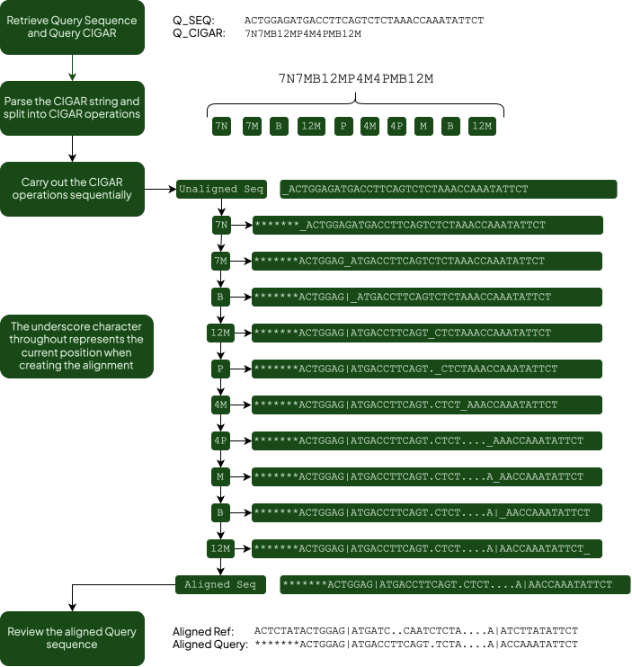

# IPD-IMGT/HLA Database XML File Proposals 

In response to feedback and requests from the user community, the IPD-IMGT/HLA Database team is proposing a series of updates to our computer readable XML files. This update will simplify the contents and parsing of the XML files and add additional features that we believe will be of use to the community. These changes will impact the following XML files: 

- hla.xml (Update details below) 
- hla_alignment.xml (New XML file, details below) 
- hla_ambigs.xml (No changes) 

# HLA XML Proposal 
Due to the continually increasing size of the database, we recognise the importance of ensuring the HLA XML remains fit for purpose. The proposed changes here are intended to streamline the HLA XML, making parsing of the file simpler, and expand the amount of information contained within to keep up with the needs of the HLA community.  

## Proposed changes to genes and pseudogenes included: 
The HLA XML file currently only contains alleles for expressed genes. A key proposal of this new XML would be expanding the information contained to include all genes and pseudogenes into the new file.  

## Proposed CIWD updates: 
We are proposing the inclusion of additional common, intermediate and well-documented (CIWD)[^1] information for all alleles where the additional information is available. This will primarily include adding information based on other alleles and groups that were published in the catalogue. 

### *For all alleles published in the CIWD catalogue:*
For those alleles that were published in the most recent CIWD allele catalogue we propose also including information on groups that the allele belongs in where applicable. These would be groups such as: 

- Allele 2 Field Name (e.g. A*01:01)
- Allele 3 Field Name (e.g. A*01:01:01) 
- P Group (e.g. A*01:01P) 
- G Group (e.g. A*01:01:01G) 

Where each of these groups appear independently in CIWD manuscript. 

### *For alleles that were not published in the CIWD catalogue:* 

For alleles not included in the original publication of the CIWD allele catalogue, we propose to also include this above group information where applicable. This would include alleles that were named after the publication.

For these alleles this additional information would be labelled with an ‘assumed’ tag to differentiate from the alleles that were originally published. 

For example, A*01:01:01:130 was named in 2026. It is a part of all the groups listed above and the CIWD data for these groups can be added to the allele entry with an ‘assumed’ label.

### *For alleles published in the CIWD catalogue, whose name has been extended or changed since catalogue publication:*

As allele names can change and update over time, we propose removing the data specifically related to the allele name while maintaining the groups which the allele is contained in.  

As a theoretical example if the allele A\*01:01:03 was extended to be A\*01:01:03:01 we would include no information specifically on A\*01:01:03:01 however we would include the appropriate group information for this allele which would include its previous name as the 3rd field name group. As this information was published in the CIWD catalogue these would be present without the ‘assumed’ tag.

## Proposed changes to data contained in the sequence tags:
We are proposing several updates to the sequence tags of the XML file. Our proposals will align this information more closely with the sequence information that is currently published in the HLA dat file.
The first major change we are proposing is the removal of any indel or alignment feature information within the sequence tags. We are now proposing that all alignment-based information is moved into a separate file format to streamline the XML usages. Please see the proposal on the HLA alignment XML below.

### *Proposed changes to data contained in the feature tags:*
We are also proposing several updates to the data contained in the feature tags within the sequence entries of the HLA XML file. To streamline the XML the feature tags will be limited to only providing the exon and intron coordinates, with all alignment information moved to a separate alignment XML file, please see the proposal below.

Alongside this we are proposing three additional changes. Firstly, the ‘status’ attribute will be removed from the feature tag as it has been causing confusion with features that are complete but not present in the CDS. Second, a ‘pseudo’ attribute will be added to the feature tag to indicate whether a specific sequence region has homology with a known exon feature, however does not contribute to the mature mRNA. An example of this would be the DQB1 variable Exon 5. Thirdly, the cDNASequence tags will be removed in favour of a CDS join entry, which brings the structure of the sequence entry more closely in line with the HLA dat file. 

### *Antigen Information Updates:*
We are also proposing to include the Broad, Split and Associated antigen assignments made by the WHO Nomenclature Committee[^2] and HATS software for each allele[^3]. The full set of possible assignment values is published in the 2026 WHO HLA Nomenclature report, while the specific assignments for each allele are available in the rel_dna_ser.txt file in the IPD-IMGT/HLA GitHub repository, as well as in the HATS GitHub repository.

## Alignment XML Documentation
Currently the information required to rebuild the IPD-IMGT/HLA alignments is distributed amongst several different file formats that are published in the IPD-IMGT/HLA Database releases.
As the IPD-IMGT/HLA text alignments that are published in the GitHub are not intended to be parsed computationally bioinformaticians are required to pull information together from different files to build alignments of HLA alleles like the ones published on the IPD-IMGT/HLA EBI website. 

### *Proposal:*
Rather than having bioinformaticians or software engineers parse several files to build the alignments we are intending on providing a single XML file containing alignment information for all alleles in the database encoded as a custom CIGAR format.
This custom implementation of the CIGARS format is informed by the SAMTools documentation[^4][^5], however there are some differences we have chosen to implement. We think that these custom operation character differences will provide significant benefits to our users and are more applicable to encoding our alignment format.
Alongside the CIGAR encodings for each allele, the new alignment XML file will include a set of full and aligned reference sequences for each gene at each level (PROT, CDS and GEN). These aligned reference sequences will include padding in line with the SAMTools ‘Padded Alignments’.

### *CIGAR format proposal:*
Reference = Reference allele for this loci and level as predefined in the file format

Query allele = The Allele being built from the CIGAR against its reference.

| Operation Character | Description |
|---------------------|-------------|
| M | Sequence Alignment Match, can be a sequence match or mismatch. |
| P | Padding sequence, can be present in both reference and query. Currently in HLA text alignments as ‘.’. |
| N | Unsequenced region in query allele compared to reference. Currently in HLA text alignments as ‘*’. |
| B | A feature boundary. Currently in HLA text alignments as ‘\|’. |

A CIGAR string is read as a series of operations. Each operation is a length followed by an operation character (for example, 12M) and describes how this stretch of the query allele relates to the reference.

M (alignment match): Both the reference and the query have a sequence character at these positions. The characters may be identical or different; M records only that sequence is present in both, not that they specifically agree with each other. Each character will be a valid nucleotide or amino acid code.

P (padding): The query has padding at these positions. Either the reference is also padded here, or the reference has sequence here, in which case the query has a deletion relative to the reference. In the HLA text alignments, padding is currently shown as ‘.’.

N (unsequenced): The query has not been sequenced at these positions, although the reference has. In the HLA text alignments, these unsequenced regions are currently shown as ‘*’.

B (feature boundary): Marks a boundary between features, such as between an exon and an intron. B always has a length of 1 (1B). It does not represent a residue in the sequence; when the sequence is written out unaligned, the boundary is inserted as an additional character at that point. In the HLA text alignments the boundaries are currently shown as ‘|’.

Please find below in figure 1 an example workflow on using the unaligned query sequence and unpacking the CIGAR into a sequence aligned against the reference. This is not a real sequence nor CIGAR and is only for example purposes.

*Figure 1. An example workflow of using a Query Sequence and Query CIGAR to build a sequence aligned against its reference.*

References:

[^1]:	Hurley CK, Kempenich J, Wadsworth K, et al. Common, intermediate and well-documented HLA alleles in world populations: CIWD version 3.0.0. HLA. Jun 2020;95(6):516–531. doi:10.1111/tan.13811

[^2]:	Marsh SGE, Osoegawa K, Bodmer WF, et al. Nomenclature for Factors of the HLA System, 2026. HLA. Mar 2026;107(3):e70595. doi:10.1111/tan.70595

[^3]:	Osoegawa K, Yim K, Jeracki M, et al. A new strategy for systematically classifying HLA alleles into serological specificities: Update and refinement. HLA. Oct 2024;104(4):e15702. doi:10.1111/tan.15702

[^4]:	Danecek P, Bonfield JK, Liddle J, et al. Twelve years of SAMtools and BCFtools. Gigascience. Feb 16 2021;10(2)doi:10.1093/gigascience/giab008

[^5]:	SAM/BAM Format Specification Working Group. Sequence Alignment/Map format specification V1.6. GitHub. Updated August 12, 2025. https://samtools.github.io/hts-specs/SAMv1.pdf
